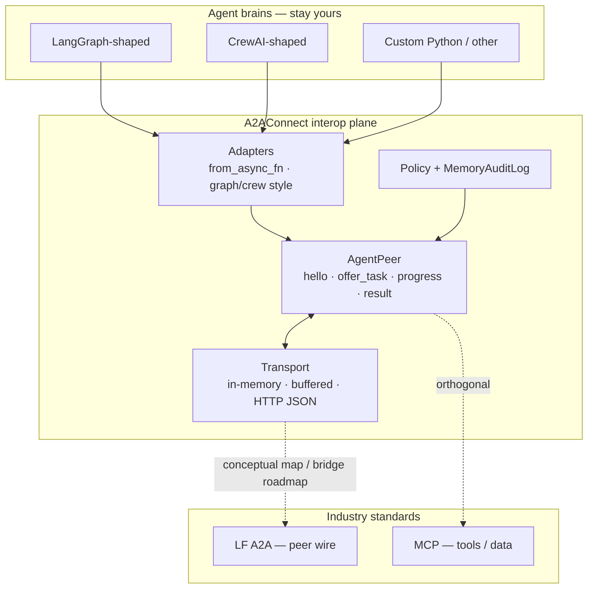

# A2AConnect

**Product site:** [https://www.a2aconnect.dev](https://www.a2aconnect.dev) · **GitHub:** [ashishodu2023/a2aconnect](https://github.com/ashishodu2023/a2aconnect)  
**Runtime:** Python 3.11+ (`a2aconnect`) · **Site:** Next.js in `apps/web`  
**Live:** https://www.a2aconnect.dev · **Repo:** https://github.com/ashishodu2023/a2aconnect

## Intention

**Problem.** Multi-agent products rarely share one SDK. A LangGraph researcher, a CrewAI writer, and a custom orchestrator cannot hand off work safely without brittle glue — and inventing a private wire protocol fights the industry standard ([LF A2A](https://a2a-protocol.org)).

**Intention.** A2AConnect is the **interop layer between agent brains**: discover peers, negotiate capabilities, hand off tasks with progress/events, and record policy + audit — **without forcing a shared agent framework**.

**What it is not.** Not a rival to LF A2A. Not a replacement for MCP.  
- **LF A2A** = peer wire standard  
- **MCP** = agent ↔ tools/data  
- **A2AConnect** = adapters + DX + governance so mixed-runtime fleets actually run

**One-liner:** *Any agent runtime can hand off work safely — without sharing an SDK.*

---

## High-level architecture

```text
┌──────────────────────────────────────────────────────────────────────────┐
│                         Your agent brains (unchanged)                     │
│     Python · LangGraph-shaped · CrewAI-shaped · OpenAI agents · custom     │
└───────────────┬──────────────────────────┬───────────────────┬────────────┘
                │ adapters                 │                   │
                ▼                          ▼                   ▼
        ┌───────────────┐          ┌───────────────┐   ┌───────────────┐
        │  AgentPeer A  │◄────────►│  AgentPeer B  │◄─►│  AgentPeer C  │
        │ + policy/audit│  transport│  (researcher) │   │   (writer)    │
        └───────┬───────┘          └───────────────┘   └───────────────┘
                │
                │  typed JSON envelopes (local interop profile)
                ▼
        ┌───────────────────────────────────────────────┐
        │  hello · capabilities · task.* · event · error │
        └───────────────────────┬───────────────────────┘
                                │  maps to (does not replace)
              ┌─────────────────┴─────────────────┐
              ▼                                   ▼
        ┌───────────┐                       ┌───────────┐
        │  LF A2A   │  peers on the wire    │    MCP    │  tools / data
        └───────────┘                       └───────────┘
```

### Same picture (Mermaid)



### Layers (top → bottom)

| Layer | Job |
|-------|-----|
| **Brains** | Your runtimes and prompts — swappable |
| **Adapters** | `run(input, ctx)` → `TaskHandler` — no SDK lock-in |
| **AgentPeer** | Handshake, capability negotiation, task handoff |
| **Policy / audit** | Allowlists + lifecycle trail for production fleets |
| **Transport** | Move the same envelopes (bus / buffer / HTTP stub) |
| **Interop profile** | Typed JSON messages — see [`protocol/SPEC.md`](protocol/SPEC.md) |

### Handoff flow

```text
hello → hello.ack → capabilities.*
        → task.offer → accept|reject
        → start → progress / event*
        → result | failed
        (+ policy gates + audit on the edges)
```

**Live diagrams:** [a2aconnect.dev/architecture](https://a2aconnect.dev/architecture) · **detail:** [docs/architecture.md](docs/architecture.md)

---

## Why this shape

| Choice | Reason |
|--------|--------|
| Adapters, not a mega-SDK | Teams keep LangGraph / Crew / custom code |
| Local interop profile | Fast DX + tests; LF A2A bridge is roadmap |
| Policy + audit on the peer | Governance without reading LLM logs |
| Pluggable transport | Same peers in-process today, across hosts later |
| MCP stays separate | Tools ≠ peer handoff |

---

## CLI

```bash
pip install -e ".[dev]"
a2aconnect doctor
a2aconnect demo support
a2aconnect map
```

## Quickstart

```bash
python3 -m venv .venv && source .venv/bin/activate
pip install -e ".[dev]"
pytest
python demos/support_desk.py      # support agents
python demos/incident_handoff.py  # incident agents
python demos/two_agents.py        # cross-runtime brief
python demos/quickstart.py        # minimal research handoff
python demos/registry_hub.py      # Gateway preview
```

```python
from a2aconnect import AgentPeer, create_bus, from_async_fn
# walkthrough: docs/getting-started.md · demos/quickstart.py
```

### Frontend (a2aconnect.dev)

```bash
cd apps/web && npm install && npm run dev   # http://127.0.0.1:4783
```

---

## Documentation

| Doc | Description |
|-----|-------------|
| [docs/README.md](docs/README.md) | Documentation hub |
| [Getting started](docs/getting-started.md) | Install + first handoff |
| [Architecture](docs/architecture.md) | Layers, flows, package map |
| [Python API](docs/python-api.md) | `AgentPeer`, handlers, outcomes |
| [Adapters](docs/adapters.md) | Wrap existing brains |
| [Transports](docs/transports.md) | Bus, buffer, HTTP JSON stub |
| [Policy & audit](docs/policy-audit.md) | Governance hooks |
| [Interop SPEC](protocol/SPEC.md) | Envelopes & message types |
| [Demos](demos/README.md) | Executable agent→agent scripts |
| [Hosting](docs/hosting-a2aconnect-dev.md) | Deploy the Next.js site |

## Layout

| Path | Role |
|------|------|
| `src/a2aconnect/` | Core library — protocol, transports, `AgentPeer`, policy/audit, adapters |
| `demos/` | Executable agent→agent demos |
| `apps/web/` | Next.js product site ([a2aconnect.dev](https://www.a2aconnect.dev)) |
| `packages/` | Optional TypeScript core/adapters (monorepo) |
| `apps/web_python_fastapi/` | Optional FastAPI/Jinja reference |
| `protocol/SPEC.md` | Local interop profile + LF A2A map |
| `docs/` | Guides and API docs |
| `tests/` | Pytest suite |

## Open-core

| Tier | What you get |
|------|----------------|
| **OSS (MIT)** | Runtime, local transports, policy/audit, demos |
| **Gateway** *(roadmap)* | Auth, routing, rate limits, hosted audit |
| **Enterprise** *(roadmap)* | SSO, VPC, retention, SLA |

## License

MIT — see [LICENSE](LICENSE)
